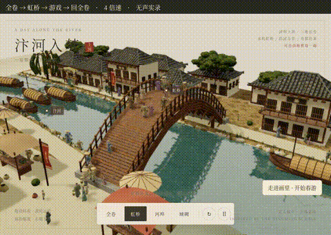
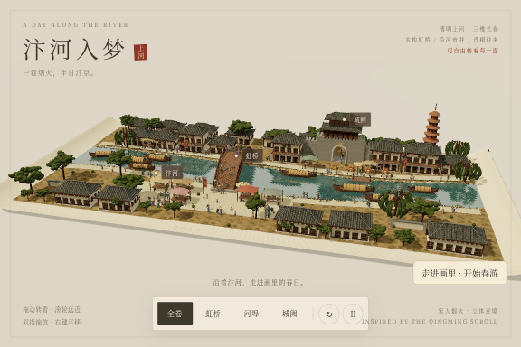
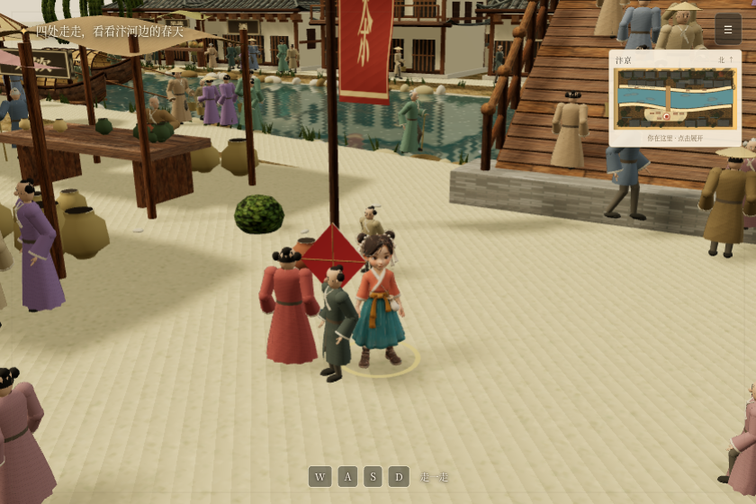
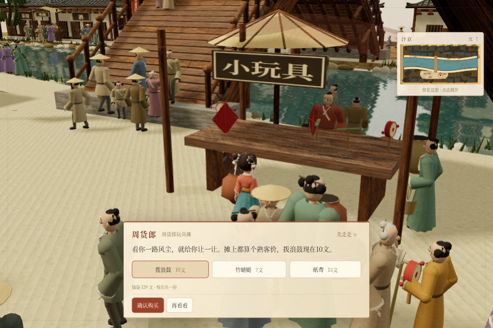
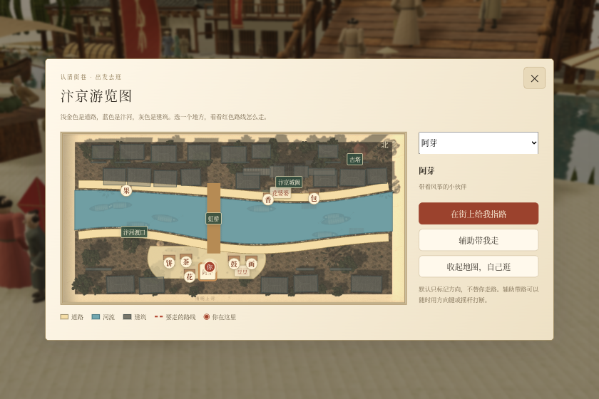
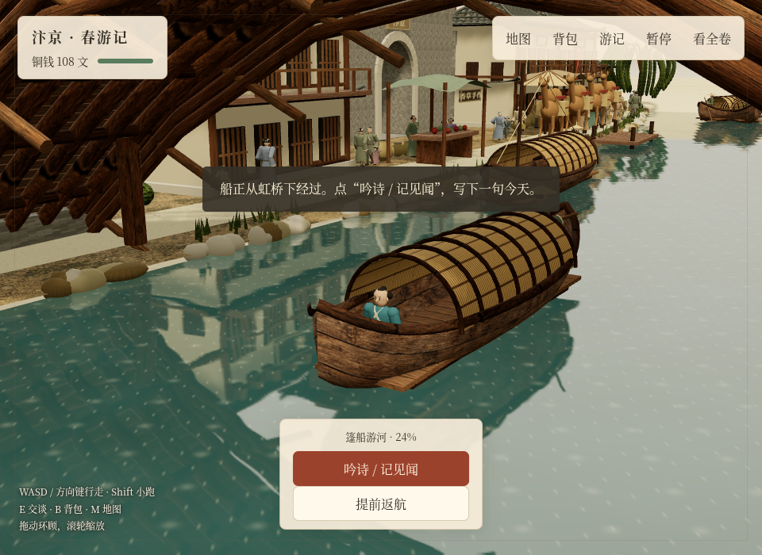

# 汴河入梦 · 阿芽的春日游会

根据提供的《清明上河图》微缩场景参考，用 Three.js 搭建的可交互长卷。这是意境式重建，未把生成图当作历史建筑的精确考证。

[在线试玩（妙搭，免登录）](https://bytedance.feishu.link/app/app_17geaupaa8v) · [观看 65 秒全卷与游戏实录](docs/media/overview-gameplay.mp4) · [观看 92 秒游玩实录](docs/media/full-gameplay.mp4)

[](docs/media/overview-gameplay.mp4)

*点击动态画面观看实际浏览器录像。全卷演示为 4 倍速、无声；录像摄于界面精简前，最新界面以在线游戏为准。*

## 游戏画面

| 沿河街市与虹桥 | 走进画里的春日游会 |
| --- | --- |
|  |  |
| 与摊主问价、还价和买东西 | 点开地图寻找摊位与景点 |
|  |  |

乘船穿过虹桥，还可以在河上吟诗、记录见闻：



## 走进画里玩一天

打开后点“出发”，可以选择男孩或女孩扮演主角。跟阿芽解开纸鸢线，找豆豆借鼓或去玩具摊买鼓后一起练习，给城门旁的花婆婆捎一枝花，再到虹桥观察风、试着放飞纸鸢。最后坐船记下一句见闻，回到岸边参加游会。也可以先去买点心、赏花或逛古塔，主线不要求按固定顺序完成。

- 电脑：WASD 或方向键行走，Shift 小跑，E 交谈，B 背包，M 地图。拖动环顾，滚轮缩放。
- 手机：左下摇杆移动，按住“跑”小跑；点靠近人物后出现的按钮互动。
- 先自己逛：走近阿芽或摊主，按 E（手机点交谈）显示场景内字幕；点击字幕可显示完整一句或继续，不会一靠近就弹出购物窗口。
- 地图是当前三维城镇的实景鸟瞰，能看到同一套屋顶、街巷、虹桥和汴河。默认“在街上给我指路”只画出金色路标；“辅助带我走”才会自动沿可通行道路走，方向键或摇杆能随时打断。
- 导航优先：浅金色道路、蓝色河流和灰色建筑轮廓分别显示，带图例和当前位置。选择目的地后，红色虚线预览真实可走路线，不画穿过建筑或河面的直线；桥、城门、渡口和古塔用于认路。
- 右上角常驻小幅实景鸟瞰图，红点和朝向标记跟着主角移动，不堆放地点名称。点击小地图或按 M，才展开原尺寸完整地图和目的地导航。
- 和摊主打过招呼后，按“看货、问价、还价、确认”逐步购物。取消输入框，一次买一份，每步最多两个回答；剧情回答较多时可点“换一句”。问价不扣钱，点“确认购买”才付款。没交谈过的店铺在地图上先显示摊位类别。
- 建筑、摊桌、陶罐、立柱、树干、长凳和河岸限制行走；主角遇到障碍会停下或沿边缘滑动，辅助带路会绕路或等待。路人也沿避开实物的道路行走。
- 拨浪鼓会摇动敲响，竹蜻蜓会旋转飞起并回到手边，纸鸢有牵线；鲜花可手持或送人，食物能吃，竹扇能扇动。
- 初始120文，关键剧情的鼓可借、花可免费获得。船费不足也有见闻换船票的方式，不会因为先买玩具卡住主线。
- 进度自动保存在当前浏览器。可暂停、继续，或在暂停菜单确认重新出发。清除浏览器数据会清除进度。

## 逐步引导、主角与声音

开场只显示当前目标和小地图。实际走过几步，才提示找阿芽交谈。靠近人物时出现互动按钮；对话期间收起目标和手持工具条，在画面底部显示紧凑字幕。获得物品后显示背包入口。右上角菜单采用紧凑浮层，保留地图、背包、声音设置和返回全卷。

男孩和女孩已换成 Tripo 生成并绑定骨骼的真实 GLB：男孩穿青蓝短衫，女孩穿珊瑚红上衣、青绿裙，都有浅色小行囊。`characters.html` 是独立、可旋转的模型预览，可切换性别、站立、行走、小跑和背面。游戏默认使用更低、更近的第三人称镜头，仍可拖动和缩放。

全卷、虹桥等观景位置和游戏里使用同一套持续活动的人群：133 名普通路人分布在桥面、两岸、集市和城门到古塔的道路上，每个区域都有男性、女性、老人和小孩；剧情角色与八位摊主完整保留。130 名路人持续行走，3 名顾客驻足看货；摊主留在摊内，有呼吸与转头动作。往返分侧走，到端点绕弯；短暂拥堵时尝试从旁边绕行，无法绕过再转向。迈步跟随实际位移，堵住时不会继续原地踏步。主角也会与阿芽、豆豆、花婆婆、骆驼和路人碰撞。长帧拆成小步，不能靠一次跨越跳过人身；暂停仍会停住整个场景。

选一句回答后，先播放主角的话，再执行选项并播放对方回应。预先合成 384 段 Edge 神经语音，男孩用 Yunxia，女孩用 Xiaoyi；部分回答加入“好呀”“咦”等语气和停顿。所有商品的提问、正常价和折后报价、还价、购买回执及铜钱不足的答复均有对应配音。单文件版内嵌音频，妙搭版从应用文件存储按需加载。其余未预录的动态文本仍使用设备中文 TTS。

说“再见”或点结束交谈会收起同一摊位的招呼提示；走离后再回来仍能交谈。“再看看”会留在当前交谈中。拨浪鼓、送花、桥上看风和坐船吟诗都在场景内完成，不再打开遮挡画面的半屏页面。大页面只用于地图、背包和故事结尾。

手持物品现在使用实际手部蒙皮顶点算出的掌心握点，同时跟随手部旋转，持物侧手臂抬到身前并减少跑步摆幅。拨浪鼓按儿童尺寸缩小，花束补上束口与花瓣；模型页可选“拿拨浪鼓”“拿花束”检查正面、侧面与跑动。当前标准骨架没有手指关节，尚不能逐指合拢，不将握点校正描述为精细抓握。

音乐、音效、对白语音在旅行菜单里分别开关，设置保存在本机；也可选择主角音色随角色切换，或固定为男孩、女孩。音乐是本地合成的轻拨弦五声音阶，音效包括脚步、选项反馈和拨浪鼓。首次点“出发”后启动声音，暂停或切到后台会停止对白并收起音乐。

Tripo 步行动画接口三次返回参数错误，均退款；当前使用导出骨骼的游戏内动作驱动，不宣称接入了 Tripo 的成品动作库。首轮自动骨架在跑动时出现手指拉长、衣摆拉扯，未通过视觉验收；最终换成标准 Mixamo 人形骨架，再检查正面、侧面与背面。人物动作仍是风格化表达，未做面部口型同步。两个人物建模和两轮绑定共消耗 200 积分，剩余 5 积分，没有自动充值。

文字交谈是本地情境脚本，不是联网通用聊天；首版不使用麦克风。人物、游会、商品价格为游戏创作，不代表历史考证。完整故事设计在 `剧本与玩法.md`。

## 跑步与游玩录像

跑步采用交替抬腿、向后屈膝和踝部回收，支撑腿不再一直锁直。男孩、女孩共用同一套步态，模型预览和游戏保持一致。

仓库内可直接观看 [65 秒全卷、虹桥与游戏切换](docs/media/overview-gameplay.mp4) 和 [92 秒游玩过程](docs/media/full-gameplay.mp4)。后者包含键盘小跑、地图找人、与阿芽交谈、解线、到玩具摊问价还价、确认购买和拿鼓把玩。两段均为实际浏览器录屏、无声；加速倍数已标在画面上，没有用生成视频或注入游戏状态代替实际游玩。

录像摄于小地图和分步购物改版前；最新界面以在线游戏为准。README 上方展示的是实机截图，动态预览点击后可打开完整 MP4。

录制脚本为 `scripts/record-gameplay.mjs`、`scripts/record-running.mjs`，原始操作记录和检查结果在录像文件夹。`scripts/package-recording.mjs` 仅裁去载入等待、加说明条并做标注加速，输出 H.264 MP4；视频封装帧率不代表实际游戏帧率。

## 打开单文件与观景模式

直接用现代浏览器打开 `index.html`。Three.js、控制器、材质贴图、两名主角模型和固定对白音频均已打包在这个 HTML 里，不需要联网下载资源，也不需要登录。当前单文件约 29 MB；手机仍需实际设备检查，未承诺低端机帧率。

- 拖动：绕场景旋转；滚轮或双指：缩放；右键或双指拖动：平移。
- 下方可切换全卷、虹桥、河埠、城阙，也可以自动环游、暂停或继续。
- 画布获得键盘焦点后，Home 回到全卷，空格暂停或继续。

## 场景内容

木构虹桥的桥面、栏杆和桥下拱架；瓦顶街市、真实开洞的城门、七层塔、背街和院墙；133 个普通微缩路人、完整剧情人物与摊主、8 艘篷船、骆驼商队，以及树木、货摊、伞棚和陶器。人物沿河岸和桥面行走，5 艘船行驶，3 艘系泊。水面有随波纹变化的实时场景倒影，树叶、幌子和船体有轻微运动。

建筑、道路和桥梁共用一套固定三维坐标，切换角度不会替换模型。生成图中对未知背面所作的推测，只作为设计参考。

## 源码和重新构建

```sh
npm install
npm run build
```

场景位于 `src/app.js`，人体模型位于 `src/people.js`。游戏流程和界面在 `src/journey.js`、`src/journey.css`；商品、对话状态、剧情与陆地行走分别在 `travel-data.js`、`travel-state.js`、`story.js`、`walk.js`。场景字幕、实景地图和路人路线在 `dialogue.js`、`survey-map.js`、`crowd.js`。`build.mjs` 将全部代码、界面与材质打包为一个 HTML。

`navigation-map.js` 叠加认路用的道路、汴河、建筑实体轮廓和路线。底图和叠加层共用场景坐标，选路调用与主角步行相同的避障算法。

## 自测

```sh
npx playwright install chromium
npm test
npm run test:browser
npm run test:revision
npm run test:controls
npm run test:boat
npm run test:scene
npm run test:guide
npm run test:characters
npm run test:ui
npm run test:holding
```

如需使用已有 Chromium，可设置 `CHROMIUM_EXECUTABLE_PATH`。测试默认直接打开本地 HTML；设置 `TEST_URL` 可测试静态服务器上的版本。

`npm test` 检查人体各姿势的连接、船只24小时数学路径、购物确认和还价、物品消耗、零钱不足时的剧情、一次性奖励、存档恢复，以及场景15个目的地之间的225条道路和11条路人的往返路线。道路障碍快照在 `tests/world-obstacles.json`，`test:revision` 会从真实浏览器重新采集。

`npm run test:browser` 用真实按钮和键盘走游戏主线，覆盖购物、玩具、合奏、送花、过桥试飞、乘船写作、返航、纸鸢结尾及手机布局。`npm run test:scene` 单独回归原有全卷观景功能。桌面页关闭后再测手机，避免争抢软件渲染资源。

`test:revision` 检查走近交谈、场景字幕、鸟瞰图、手动引路和购物确认；`test:controls` 检查键盘跑动、暂停、位置存档、全卷环顾及手机原生触摸摇杆。这里列的是测试范围，实际通过与未完成项以验收记录为准。

`tests/crowd-liveliness.mjs` 用真实场景快照重放人群，检查每个街区是否持续前进，而不只是有微小位移；同时约束转向速度、无瞬移、无穿模和静止时不迈步。`CROWD_LONG=1 node tests/crowd-liveliness.mjs` 延长至 90 秒，逐个 30 秒窗口检查是否逐渐堵住；加 `CROWD_DT=0.7` 检查慢帧。`tests/crowd-avoidance.mjs` 另检查不同渲染间隔下，固定步长的人群模拟结果相同。`tests/crowd-browser.mjs` 用原生按钮切换全卷、虹桥、游戏和回到全卷，读取真实位置与迈步时钟并录制画面。

开发环境使用桌面 Chromium 和手机视口模拟，不等同于真机性能测试。实时倒影会增加绘制开销；手机降低倒影分辨率和像素比，软件渲染环境进一步降低倒影、阴影分辨率。慢帧下互动动画限制单帧推进，避免点击后整段动画直接跳过。

具体检查结果、截图说明及独立复查记录见 [验收记录](VERIFICATION.md)。

人群实录见上方 [全卷、虹桥与游戏切换](docs/media/overview-gameplay.mp4)。软件渲染录屏不作为客户端流畅度测试。

## 参考与素材

- `modeling-reference.png`：内置图像生成工具生成的同一布局多角度设计参考。
- `src/material-atlas.png`：同一工具生成的木纹、灰瓦、泥土和树叶材质。
- 两次生成的提示词及固定布局要求见 `IMAGE-PROMPTS.md`。
- Three.js 使用 MIT 协议，许可证随最终 HTML 一并提供。
- `characters/reference/` 保存内置 imagegen 生成的角色三视图、男女角色正面图；`characters/boy/`、`characters/girl/` 保存 Tripo 实际生成的 GLB、预览和任务记录。`scripts/generate-voices.mjs` 可重新生成固定对白；普通打开游戏不会调用语音服务。

之前的锦鲤池项目未作改动。本游戏已独立发布至 [妙搭汴河春游](https://bytedance.feishu.link/app/app_17geaupaa8v)，开放匿名访问，推荐 PC。发布状态与资源清单在 `deployment/`；线上工程为同级 `qingming-riverside-miaoda`，本地单文件仍独立保留。
