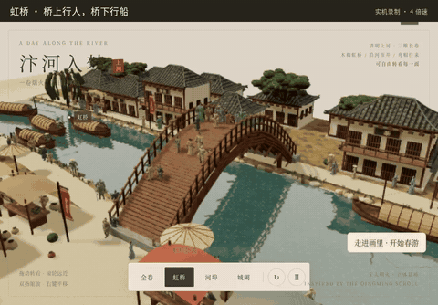
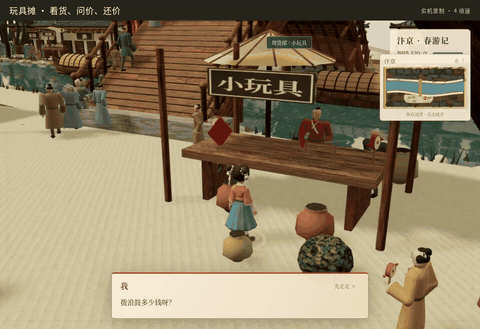
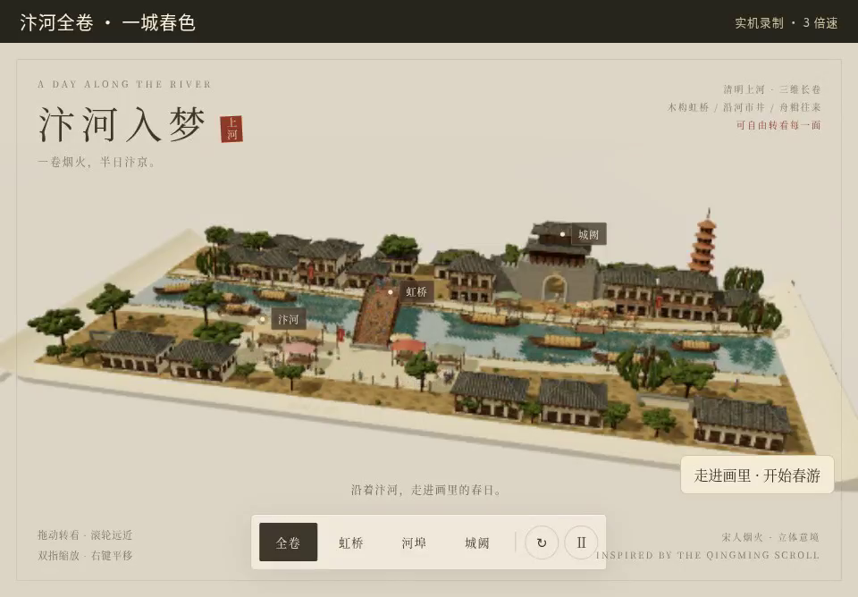
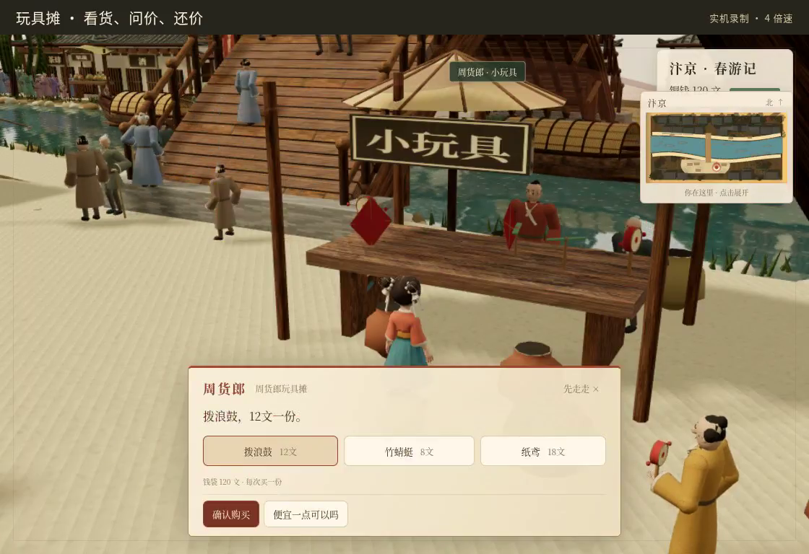
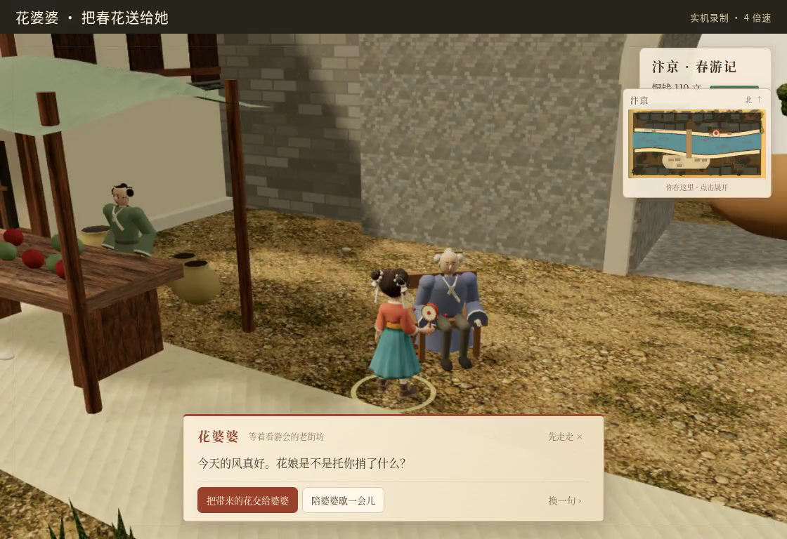
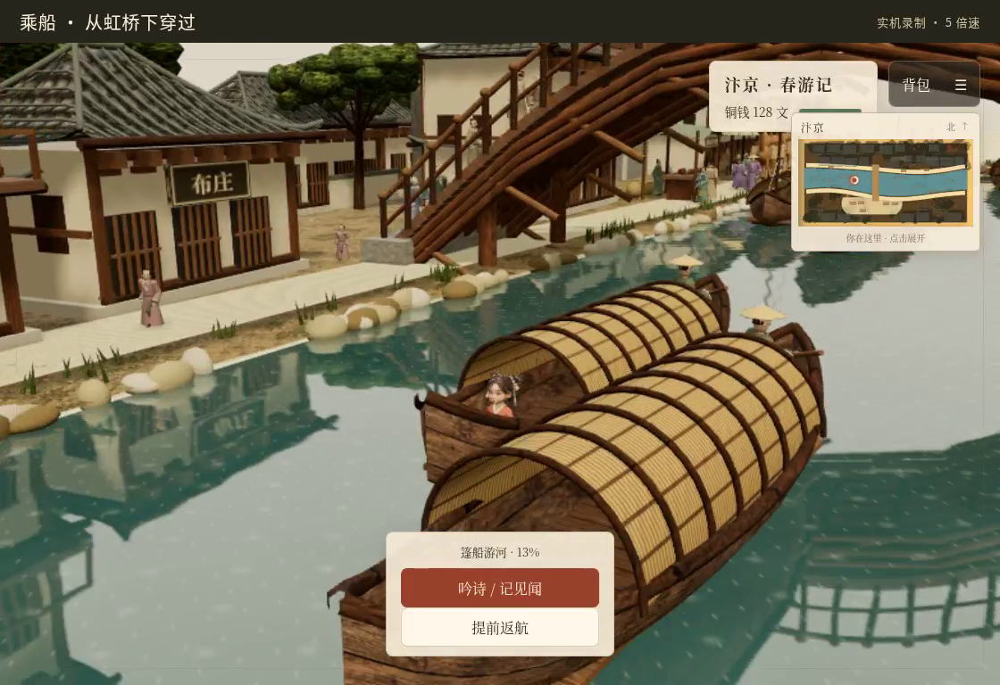

# 汴河入梦 · 阿芽的春日游会

走进《清明上河图》：逛集市、上虹桥、坐船吟诗，和阿芽一起完成春日游会。

[在线试玩（免登录）](https://bytedance.feishu.link/app/app_17geaupaa8v) · [查看单文件 HTML](index.html)

## 两支实机视频

[](docs/media/panorama-showcase.mp4)

[全景展示 · 42 秒](docs/media/panorama-showcase.mp4)

[](docs/media/journey-showcase.mp4)

[游玩展示 · 2 分 44 秒](docs/media/journey-showcase.mp4)：逛摊位、上桥、送花、坐船、放纸鸢。

视频为实机录制；较长的赶路过程已快放。

## 游戏画面

| 汴河全卷 | 玩具摊问价 |
| --- | --- |
|  |  |
| 给花婆婆送花 | 坐船经过虹桥 |
|  |  |

## 怎么玩

选小男孩或小女孩出发，靠近人物即可交谈。用小地图找路。

电脑：WASD／方向键移动，Shift 小跑，E 互动，M 地图，B 背包。手机：摇杆和屏幕按钮。

直接打开 [index.html](index.html) 就能离线游玩。想从源码重新构建：

```sh
npm install
npm run build
npm test
```

更多内容：[剧本与玩法](剧本与玩法.md) · [验收记录](VERIFICATION.md)。
